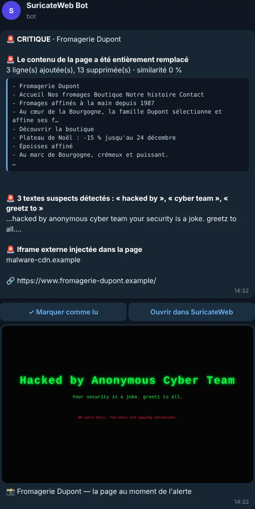

Un seul message est envoyé par contrôle, même si plusieurs anomalies sont détectées. Il contient la gravité, le site, le détail et un extrait des lignes modifiées. Pour une alerte **critique visible sur la page** (contenu remplacé, script ou iframe injectés, redirection), il est suivi d'une **photo de la page au moment de l'alerte**.

## Configuration

1. Dans Telegram, ouvrez **@BotFather**, envoyez `/newbot` et copiez le jeton fourni.
2. Dans SuricateWeb, **Réglages › Notifications Telegram** : collez le jeton, puis envoyez `/start` à votre nouveau bot (ou ajoutez-le dans un groupe).
3. Cliquez sur **Détecter** : SuricateWeb retrouve votre identifiant de conversation tout seul.
4. Cliquez sur **Tester**, puis **Enregistrer**.

Le jeton, une fois enregistré, n'est plus renvoyé au navigateur qu'abrégé.

## Options

| Option | Effet |
|---|---|
| Notifications actives | Coupe tous les envois sans perdre la configuration |
| Rétablissement | Message « ✅ Rétabli » quand un incident disparaît |
| Extrait des changements | Les premières lignes ajoutées ou supprimées, dans le message |
| Capture d'écran jointe | Une photo de la page pour les alertes critiques visibles |
| Niveau minimal | « Attention et critique » par défaut ; « Critique uniquement » pour moins de bruit |
| Boutons | « Marquer comme lu » et « Ouvrir dans SuricateWeb » sous chaque message |

## Boutons sous les alertes

- **✓ Marquer comme lu** marque comme lues les alertes de ce site, jusqu'à la dernière de ce message, sans ouvrir l'application. SuricateWeb reçoit le clic en interrogeant Telegram : **aucune adresse publique à ouvrir**, cela marche aussi en local.
- **Ouvrir dans SuricateWeb** exige que l'**adresse publique de SuricateWeb** (Réglages) soit joignable depuis un téléphone. Telegram refuse `localhost` et les réseaux privés : le bouton est alors omis et le lien reste dans le texte.
- Seule la conversation configurée a le droit d'agir. Si le bot est dans un **groupe**, tous ses membres peuvent cliquer : c'est une limite de Telegram.

:::caution
Telegram n'admet qu'**un seul lecteur** par bot. Si un **webhook** est configuré pour ce bot (par un autre outil), SuricateWeb ne reçoit plus les clics : supprimez le webhook ou coupez les boutons.
:::
