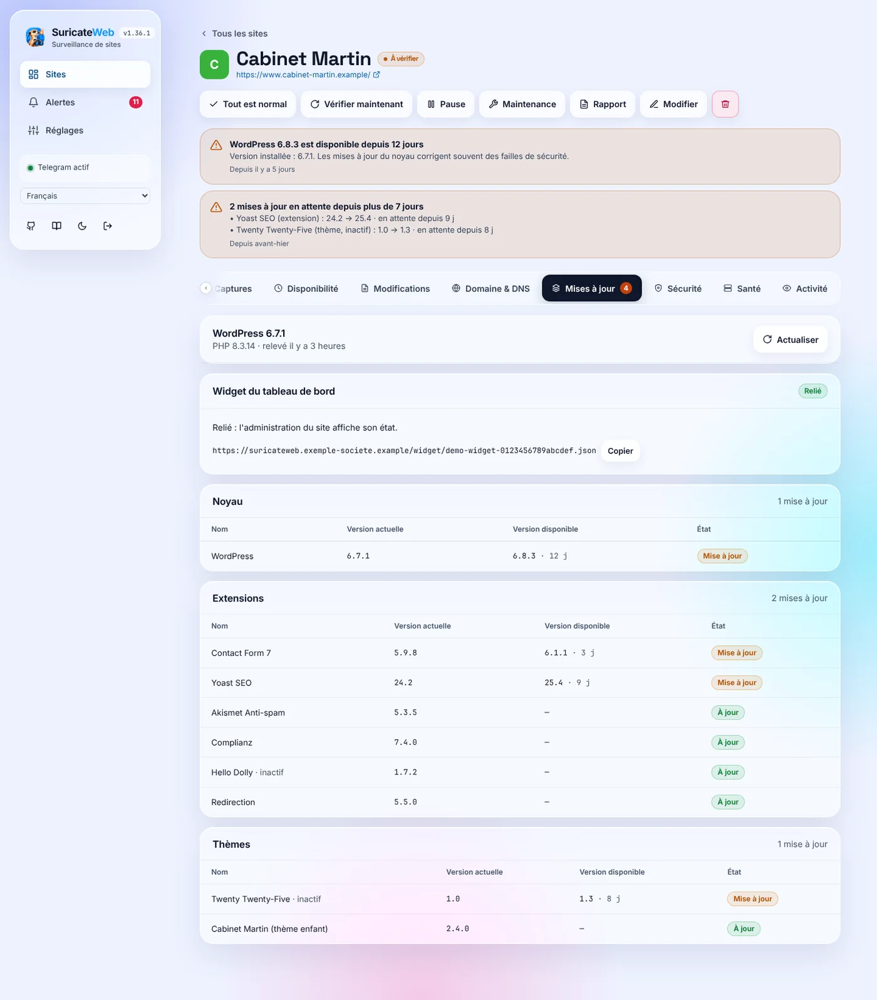

Un petit plugin, installé sur votre site, permet à SuricateWeb de lire ce qu'un contrôle extérieur ne voit pas : la version de PHP, les **mises à jour** du noyau, des extensions et des thèmes, l'**intégrité des fichiers**, les comptes administrateurs, la **santé du serveur**. Le plugin **n'envoie rien de lui-même** : c'est SuricateWeb qui vient lire, avec un jeton.

## Installation

1. Dans SuricateWeb, ouvrez la fiche du site (**Modifier**), section **WordPress / PrestaShop** : choisissez le CMS. Un **jeton** est généré.
2. Téléchargez le plugin depuis cette même section (WordPress : une archive `.zip` ; PrestaShop : un module `.zip`).
3. Installez-le comme n'importe quelle extension, puis **activez-le**.
4. Collez le jeton dans les réglages du plugin :
   - **WordPress** : *Outils › SuricateWeb › Réglages*
   - **PrestaShop** : *Modules › Gestionnaire de modules › SuricateWeb › Configurer*
5. Dans SuricateWeb, ouvrez le site, onglet **Mises à jour**, puis cliquez sur **Actualiser**.

:::note
SuricateWeb relève le plugin **toutes les 12 heures** par défaut (réglable de 1 heure à 7 jours). Après l'installation ou une mise à jour du plugin, cliquez sur **Actualiser** pour ne pas attendre le prochain relevé.
:::

## Mises à jour surveillées

L'onglet **Mises à jour** montre le noyau, les extensions (ou modules) et les thèmes, avec la **version installée** et la **version disponible**. Une alerte part quand une mise à jour tarde : **7 jours** par défaut (réglable), **critique** pour le noyau au bout de 30 jours. La **fin de support de PHP** est aussi signalée.

## Ce qui circule

- Le plugin ne renvoie que : la version de PHP et du CMS, et pour chaque extension, module ou thème son nom, son identifiant, sa version, la version disponible et son état. S'y ajoutent le nombre d'administrateurs, des chemins de fichiers (jamais leur contenu) pour l'intégrité et le code suspect, et des faits sur le serveur pour la santé. Ni e-mail, ni mot de passe, ni contenu, ni donnée client.
- Sans jeton valide (comparé en temps constant), le plugin répond « non autorisé » et ne renvoie rien.
- Cette liste reste **sensible** : elle indique à un attaquant quelles failles tenter. Gardez le jeton secret et surveillez un site **en HTTPS**.

## Quelle version pour quelle fonction

| Fonction | WordPress | PrestaShop |
|---|---|---|
| Mises à jour et version de PHP | 1.0 | 1.0 |
| Comptes administrateurs | 1.1 | 1.1 |
| Intégrité des fichiers | 1.1 (sommes de contrôle officielles) | partielle |
| Code suspect | 1.3 | 1.3 |
| [Widget du tableau de bord](/cms/dashboard-widget/) | 1.4 | 1.4 |
| [Santé du serveur](/cms/health-and-hardening/) | 1.5 | 1.5 |
| [Durcissement](/cms/health-and-hardening/#durcissement-en-un-clic) | 1.6 | non |
| Page du plugin (Données du site) | 1.8 | 1.6 |
| [Journal d'activité](/cms/activity-log/) | 1.7 | non |

Un plugin plus ancien continue de fournir ce qu'il sait faire ; l'onglet concerné indique alors « plugin trop ancien » et propose la mise à jour. **Remplacez le plugin par la nouvelle archive** : le jeton est conservé.
