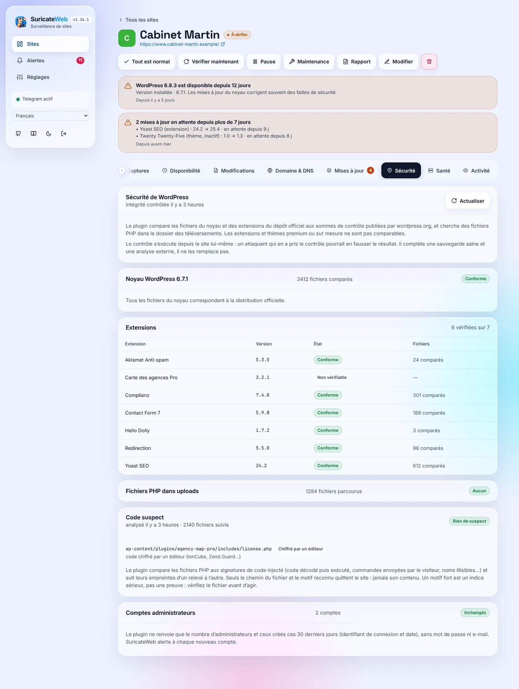

SuricateWeb voit le HTML d'un site, pas ses fichiers. Le plugin comble ce manque : il lit les fichiers **depuis le site**, là où ils sont. L'onglet **Sécurité** (sites WordPress et PrestaShop) en présente le résultat.

## Intégrité des fichiers (WordPress)

| Contrôle | Alerte |
|---|---|
| **Noyau de WordPress** comparé aux sommes de contrôle officielles de wordpress.org | **critique** si un fichier est modifié ou ajouté |
| **Extensions du dépôt officiel**, une par une | **critique** si un fichier est modifié ou ajouté |
| **Fichiers PHP dans `uploads/`** | **critique** : c'est l'endroit habituel d'une porte dérobée |

Les extensions premium ou sur mesure, et les thèmes sur mesure, ne peuvent pas être comparés : l'onglet l'indique (« Non vérifiable ») au lieu de les déclarer conformes. Le contrôle est lourd : le plugin le borne à 60 secondes et garde le résultat 30 minutes.

## Code suspect

Les sommes de contrôle ne couvrent ni les thèmes sur mesure, ni les extensions premium, ni PrestaShop. Le plugin cherche donc aussi, **dans les fichiers PHP du site**, ce qui ressemble à du code injecté : code décodé puis exécuté, exécution de ce qu'envoie le visiteur, JavaScript obfusqué, contenu différent pour les robots de recherche, PHP caché dans des images…

- Seuls le **chemin**, l'identifiant du motif reconnu et une **empreinte courte** sont transmis, **jamais le contenu** d'un fichier.
- Un fichier ajouté ou modifié hors mise à jour est signalé ; un fichier connu et légitime se marque avec **Je connais ce fichier** (sa nouvelle modification redevient une alerte).
- Une extension dont le code est chiffré par son éditeur (ionCube, Zend Guard) est listée à part, sans alerte.

## Comptes administrateurs

SuricateWeb compte les administrateurs du site. Un **nouveau compte** apparaît en alerte **critique**, avec son identifiant et sa date de création (WordPress). Si vous le connaissez, cliquez sur **Je connais ces comptes** : il devient la référence.

:::caution
Ces contrôles tournent **depuis le site lui-même** : un attaquant qui en a pris le contrôle pourrait en falsifier le résultat. Ils complètent une sauvegarde saine et une analyse externe ; ils ne les remplacent pas.
:::
