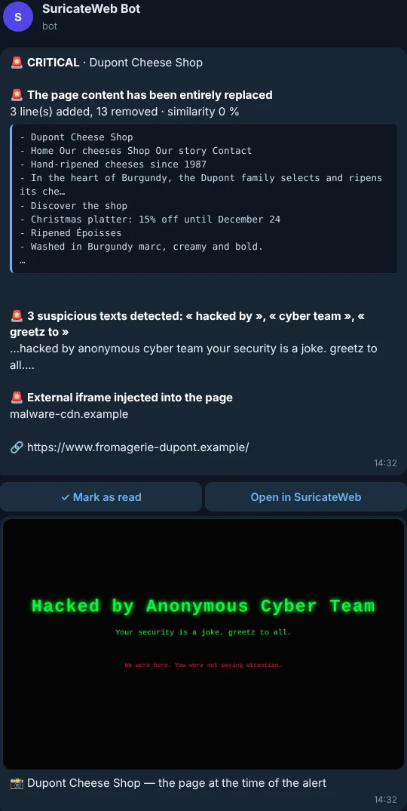

One message is sent per check, even when several anomalies are detected. It contains the severity, the site, the detail and an extract of the changed lines. For a **critical alert that is visible on the page** (content replaced, script or iframe injected, redirect), it is followed by a **photo of the page at the time of the alert**.

## Setup

1. In Telegram, open **@BotFather**, send `/newbot` and copy the token you are given.
2. In SuricateWeb, **Settings › Telegram notifications**: paste the token, then send `/start` to your new bot (or add it to a group).
3. Click **Detect**: SuricateWeb finds your conversation ID by itself.
4. Click **Test**, then **Save**.

Once saved, the token is only sent back to the browser in abbreviated form.

## Options

| Option | Effect |
|---|---|
| Notifications on | Turns off all sending without losing the configuration |
| Recovery | “✅ Recovered” message when an incident goes away |
| Extract of the changes | The first lines added or removed, in the message |
| Screenshot attached | A photo of the page for visible critical alerts |
| Minimum level | “Warning and critical” by default; “Critical only” for less noise |
| Buttons | “Mark as read” and “Open in SuricateWeb” under each message |

## Buttons under alerts

- **✓ Mark as read** marks the site's alerts as read, up to the last one in this message, without opening the application. SuricateWeb receives the click by polling Telegram: **no public address to open**, it works locally too.
- **Open in SuricateWeb** requires SuricateWeb's **public address** (Settings) to be reachable from a phone. Telegram refuses `localhost` and private networks: the button is then left out and the link stays in the text.
- Only the configured conversation may act. If the bot is in a **group**, all its members can click: that is a Telegram limitation.

:::caution
Telegram allows only **one reader** per bot. If a **webhook** is set for this bot (by another tool), SuricateWeb no longer receives the clicks: remove the webhook or turn the buttons off.
:::
