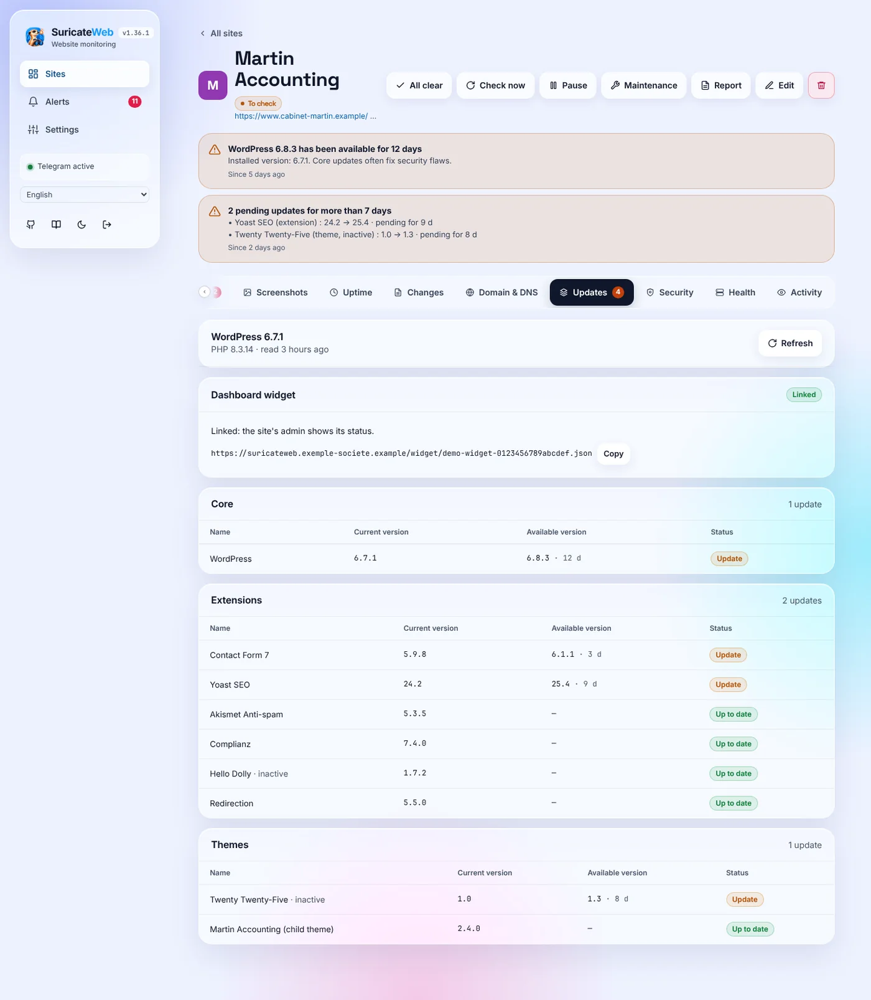

A small plugin, installed on your site, lets SuricateWeb read what an outside check cannot see: the PHP version, **updates** to the core, plugins and themes, **file integrity**, administrator accounts and **server health**. The plugin **sends nothing by itself**: SuricateWeb comes to read it, with a token.

## Installation

1. In SuricateWeb, open the site (**Edit**), **WordPress / PrestaShop** section: choose the CMS. A **token** is generated.
2. Download the plugin from the same section (WordPress: a `.zip` archive; PrestaShop: a module `.zip`). The **WordPress plugin** and **PrestaShop plugin** buttons at the top of the sites list offer it too, with the shipped **version**.
3. Install it like any extension, then **activate** it.
4. Paste the token into the plugin's settings:
   - **WordPress**: *Tools › SuricateWeb › Settings*
   - **PrestaShop**: *Modules › Module Manager › SuricateWeb › Configure*
5. In SuricateWeb, open the site, **Updates** tab, then click **Refresh**.

**In video**

WordPress:

<a href="https://youtu.be/knxh3RBF0HI">Open on YouTube: WordPress support</a>

PrestaShop:

<a href="https://youtu.be/FWANjLkVHvc">Open on YouTube: PrestaShop support</a>

:::note
SuricateWeb reads the plugin **every 12 hours** by default (adjustable from 1 hour to 7 days). After installing or updating the plugin, click **Refresh** so you do not wait for the next reading.
:::

## Monitored updates

The **Updates** tab shows the core, the plugins (or modules) and the themes, with the **installed version** and the **available version**. An alert goes out when an update is late: **7 days** by default (adjustable), **critical** for the core after 30 days. The **end of PHP support** is also reported.

## In the sites list

For each site linked to the plugin, the list shows what the last reading found, without opening the site:

| Badge | What it says |
|---|---|
| **WP v1.8.1** / **PS v1.6.1** | the **plugin** version installed on the site. **Green**: up to date. **Orange** with ↑: a newer version is shipped. **Red** “unreachable”: the last reading failed. **Grey** “pending”: no reading yet |
| **PHP 8.3.14** | the site's PHP version. **Orange** when security support for that branch is about to end (within 90 days), **red** once it has ended |
| **WordPress 6.7.1** / **PrestaShop 8.1.7** | the CMS version, **orange** with ↑ when a newer version exists |
| **4 updates** | the number of pending updates: the CMS, plus each plugin (or module) and each theme that announces one. It is the same count as in the monthly report. The detail shows on hover, the full list in the **Updates** tab |

- Nothing is shown for a site without a CMS, in “domain only” mode, or until a reading has succeeded. If a later reading fails, the **last known value** stays displayed, and the plugin badge turns red.
- On a narrow screen this column is hidden: an icon for the CMS link remains.

### Download or update the plugin

At the top of the list, **WordPress plugin** and **PrestaShop plugin** download the current archive, with its version. An orange marker, for example **1 ↑**, shows **how many sites** have an older plugin: time to replace the plugin on those sites. The buttons only appear if your access allows downloading plugins: a read-only guest does not see them.

## What travels

- The plugin only returns: the PHP and CMS versions, and for each plugin, module or theme its name, identifier, version, the available version and its state. It also returns the number of administrators, file paths (never their content) for integrity and suspicious code, and server facts for health. No email, no password, no content, no customer data.
- Without a valid token (compared in constant time), the plugin answers “unauthorized” and returns nothing.
- That list remains **sensitive**: it tells an attacker which flaws to try. Keep the token secret and monitor a site **over HTTPS**.

## Which version for which feature

| Feature | WordPress | PrestaShop |
|---|---|---|
| Updates and PHP version | 1.0 | 1.0 |
| Administrator accounts | 1.1 | 1.1 |
| File integrity | 1.1 (official checksums) | partial |
| Suspicious code | 1.3 | 1.3 |
| [Dashboard widget](/en/cms/dashboard-widget/) | 1.4 | 1.4 |
| [Server health](/en/cms/health-and-hardening/) | 1.5 | 1.5 |
| [Hardening](/en/cms/health-and-hardening/#one-click-hardening) | 1.6 | no |
| Plugin page (Site data) | 1.8 | 1.6 |
| [Activity log](/en/cms/activity-log/) | 1.7 | no |

An older plugin keeps providing what it knows how to do; the tab concerned then says “plugin too old” and offers the update. **Replace the plugin with the new archive**: the token is kept.
