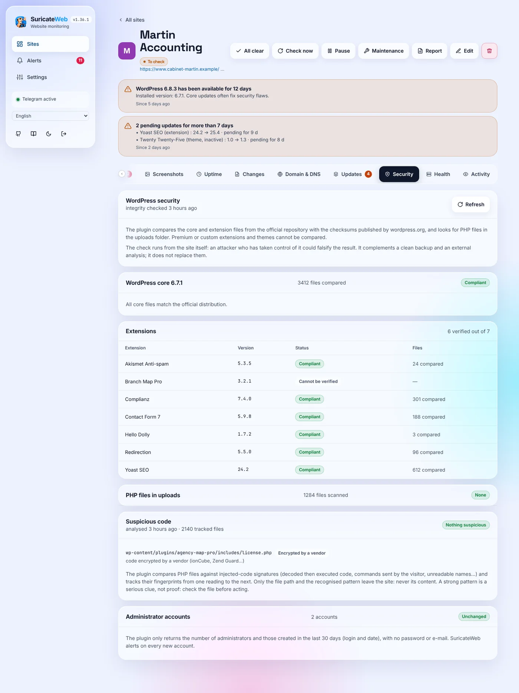

SuricateWeb sees a site's HTML, not its files. The plugin fills that gap: it reads the files **from the site itself**, where they are. The **Security** tab (WordPress and PrestaShop sites) presents the result.

## File integrity (WordPress)

| Check | Alert |
|---|---|
| **WordPress core** compared with the official checksums published by wordpress.org | **critical** if a file is modified or added |
| **Plugins from the official repository**, one by one | **critical** if a file is modified or added |
| **PHP files in `uploads/`** | **critical**: the usual place for a backdoor |

Premium or custom plugins, and custom themes, cannot be compared: the tab says so (“Cannot be verified”) instead of declaring them compliant. The check is heavy: the plugin caps it at 60 seconds and keeps the result for 30 minutes.

## Suspicious code

Checksums cover neither custom themes, nor premium plugins, nor PrestaShop. So the plugin also looks, **in the site's PHP files**, for what looks like injected code: code decoded then executed, execution of what the visitor sends, obfuscated JavaScript, different content for search-engine robots, PHP hidden in images…

- Only the **path**, the identifier of the pattern recognised and a **short fingerprint** are transmitted, **never the content** of a file.
- A file added or modified outside an update is flagged; a known, legitimate file is marked with **I know this file** (a later modification becomes an alert again).
- A plugin whose code is encrypted by its publisher (ionCube, Zend Guard) is listed separately, without an alert.

## Administrator accounts

SuricateWeb counts the site's administrators. A **new account** raises a **critical** alert, with its login and creation date (WordPress). If you know it, click **I know these accounts**: it becomes the baseline.

:::caution
These checks run **from the site itself**: an attacker who has taken control of it could falsify the result. They complement a clean backup and an outside analysis; they do not replace them.
:::
