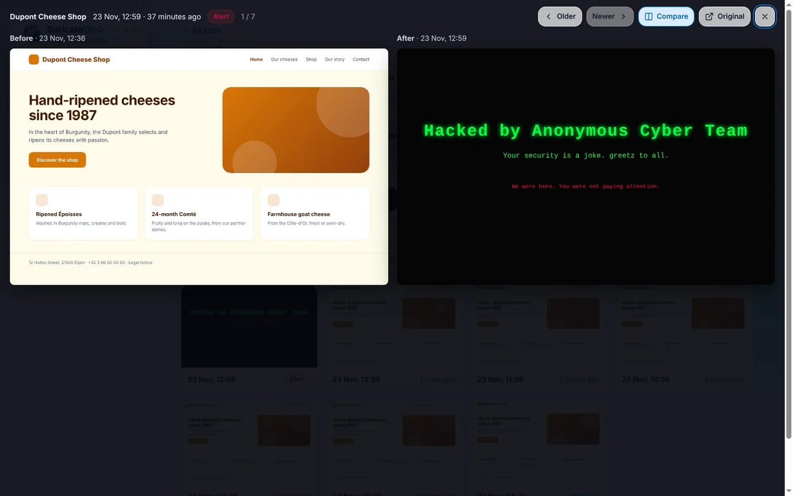

SuricateWeb photographs your pages with a real browser (Chrome or Chromium). You see what your visitors see, even when the text has not changed.

## What you can do

- **Scheduled screenshots**: at the frequency you choose, with a number of screenshots kept per site.
- **Manual screenshots** and **alert screenshots** (attached to visible critical alerts).
- **Capture the full page**: turned on by default for new sites.
- **Compare** two screenshots side by side, before and after a change or a hack.

## Alert when the appearance changes

SuricateWeb compares each scheduled screenshot with the previous one and measures the percentage of the page that changed. Beyond a threshold an alert goes out (on Telegram, with the image of the changed areas in red):

- **critical** from 50% of the page changed: a replaced page;
- the alert is only sent for a **scheduled** screenshot, and only if the previous one had already been compared;
- it is **held back during a maintenance window**.

The threshold, the colour tolerance and the areas to ignore (a carousel, a clock, an ad) are set per site.

:::note
Screenshots need a browser on the server. On the hosted version, they are included in the plans that provide them. When self-hosting, install Chrome or Chromium, or point to a remote browser (see [Self-hosting](/en/self-hosting/)).
:::
