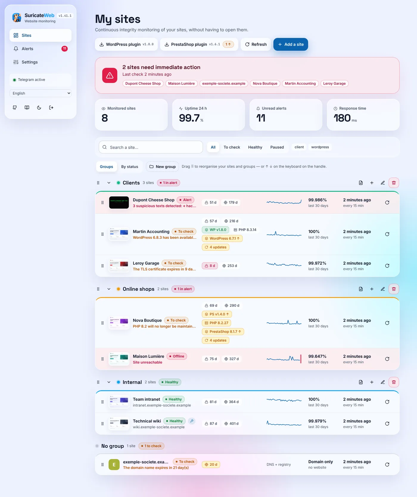

## Site content

| Signal | Detects |
|---|---|
| Page content | Text changes; a **complete replacement** (similarity < 25%) is critical; an almost empty page |
| Suspicious keywords | “hacked by”, default nginx or Apache pages, “domain for sale”, suspended account, pharma or casino spam… (editable list) |
| Required or forbidden texts | Your own keywords, site by site |
| Title | A change of `<title>` |
| Scripts | A new JavaScript file (external: critical); obfuscated JavaScript |
| Links, iframes, forms | An injected external iframe, a form hijacked to another domain, `meta refresh`, newly linked domains (SEO spam) |

Every version of the content is kept (the last 300 per site) and can be compared with the previous one in the **Changes** tab.

## Redirects and certificate

- **Redirects**: to another domain, back to unencrypted HTTP, a change of the server software.
- **TLS certificate**: invalid, expired, expiring soon, a change of issuer (critical) or a simple renewal (info).

## Uptime

A site is **down** if it does not respond or returns a real HTTP error (5xx, 404…). Restricted access (401, 403, 429) counts as “reachable”. An outage is **confirmed** after several consecutive failures (2 by default, adjustable) to avoid false alarms, but it is **dated from the first failure**.

- Uptime over **24 hours, 7, 30 and 90 days**, computed in time from the real duration of outages: it stays accurate whatever the check frequency.
- A **90-day timeline** (one bar per day) and the outage history: start, end, duration, cause.
- **Response time**: average, minimum and maximum.
- **Pausing** a site closes an ongoing outage: a pause does not count as downtime.

## Domain and DNS

The **Domain & DNS** tab of each site, or the **Domain only** type for a name with no website. The most serious changes are **critical**: name servers (NS) changed, registry delegation modified, registrar changed or transfer in progress, “pending transfer”, “hold” or “redemption” statuses, DNSSEC turned off. **Warnings**: transfer lock removed, changes to MX, SPF, DMARC, CNAME or CAA, public resolvers disagreeing, a new IP address range.

The **domain expiry date** is tracked: an alert is raised as it approaches.

## Maintenance windows

Schedule a maintenance window from a site's page: during it, alerts are **held back** (and do not count as downtime), then **a single summary message** is sent when it ends.

## Keeping noise down

One message is sent per check, even when several anomalies are detected; an outage is only confirmed after several failures; every signal can be turned off site by site. The **All clear** button acknowledges a site's alerts.
