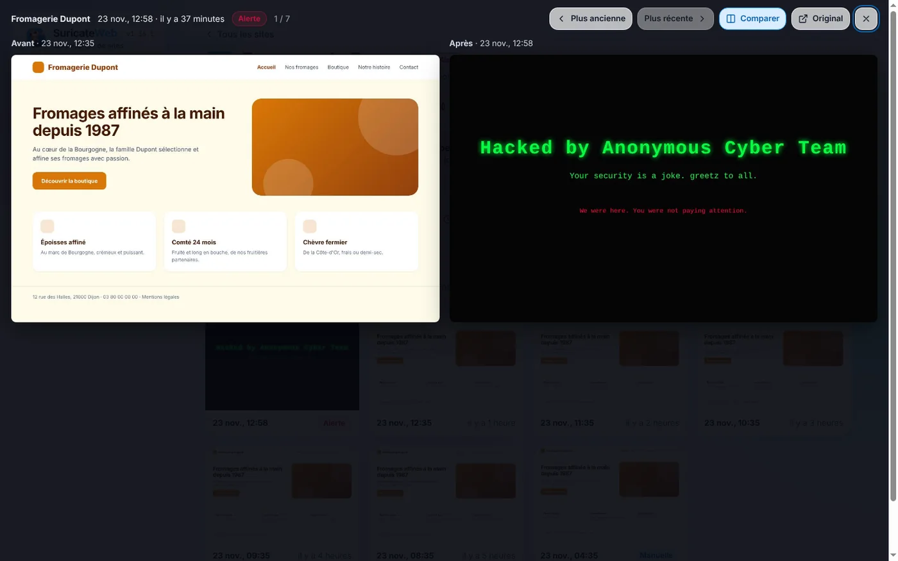

SuricateWeb photographie vos pages avec un vrai navigateur (Chrome ou Chromium). On voit ainsi ce que voient les visiteurs, même quand le texte n'a pas changé.

## Ce que vous pouvez faire

- **Capture planifiée** : à la fréquence de votre choix, avec un nombre de captures conservées par site.
- **Capture manuelle** et **capture d'alerte** (jointe aux alertes critiques visibles).
- **Capturer la page entière** : activé par défaut pour les nouveaux sites.
- **Comparer** deux captures côte à côte, avant et après un changement ou un piratage.

## Alerte quand l'apparence change

SuricateWeb compare chaque capture planifiée à la précédente et mesure le pourcentage de la page qui a changé. Au-delà d'un seuil, une alerte part (sur Telegram, avec l'image des zones modifiées en rouge) :

- **critique** à partir de 50 % de la page modifiée : une page remplacée ;
- l'alerte n'est envoyée que pour une capture **planifiée**, et seulement si la capture précédente avait déjà été comparée ;
- elle est **retenue pendant une maintenance**.

Le seuil, la tolérance de couleur et les zones à ignorer (un carrousel, une horloge, une publicité) se règlent par site.

:::note
Les captures demandent un navigateur sur le serveur. Sur la version hébergée, elles sont incluses dans les forfaits qui les prévoient. En auto-hébergement, installez Chrome ou Chromium, ou pointez vers un navigateur distant (voir [Auto-hébergement](/self-hosting/)).
:::
