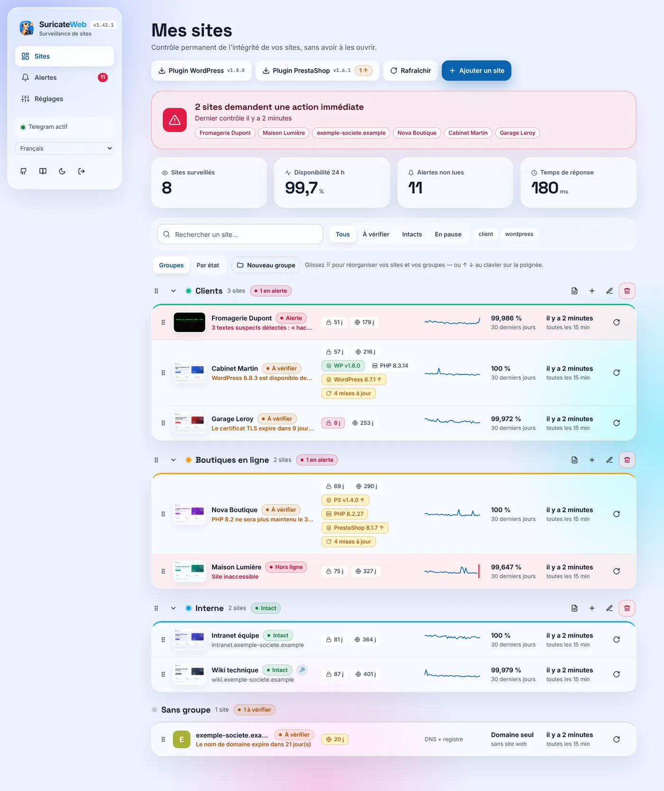

## Contenu du site

| Signal | Détecte |
|---|---|
| Contenu de la page | Modification du texte ; **remplacement total** (similarité < 25 %) classé critique ; page quasi vide |
| Mots-clés suspects | « hacked by », pages par défaut nginx ou Apache, « domaine à vendre », compte suspendu, spam pharmaceutique ou casino… (liste modifiable) |
| Textes obligatoires ou interdits | Vos propres mots-clés, site par site |
| Titre | Changement de `<title>` |
| Scripts | Nouveau fichier JavaScript (externe : critique) ; JavaScript obfusqué |
| Liens, iframes, formulaires | Iframe externe injectée, formulaire détourné vers un autre domaine, `meta refresh`, nouveaux domaines liés (spam SEO) |

Chaque version du contenu est conservée (les 300 dernières par site) et comparable à la précédente dans l'onglet **Modifications**.

## Redirections et certificat

- **Redirections** : vers un autre domaine, retour en HTTP non chiffré, changement du logiciel serveur.
- **Certificat TLS** : invalide, expiré, expiration proche, changement d'émetteur (critique) ou simple renouvellement (info).

## Disponibilité

Un site est **en panne** s'il ne répond pas ou renvoie une vraie erreur HTTP (5xx, 404…). Les accès restreints (401, 403, 429) comptent comme « joignable ». La panne est **confirmée** après plusieurs échecs consécutifs (2 par défaut, réglable) pour éviter les fausses alertes, mais elle est **datée du premier échec**.

- Disponibilité sur **24 h, 7, 30 et 90 jours**, calculée en temps à partir de la durée réelle des pannes : elle reste exacte quelle que soit la fréquence de contrôle.
- **Frise de 90 jours** (une barre par jour) et historique des pannes : début, fin, durée, cause.
- **Temps de réponse** moyen, minimal et maximal.
- Mettre un site **en pause** clôt une panne en cours : la pause ne compte pas comme indisponibilité.

## Domaine et DNS

Onglet **Domaine & DNS** de chaque site, ou type **Domaine seul** pour un nom sans site web. Les changements les plus graves sont **critiques** : serveurs de noms (NS) changés, délégation au registre modifiée, registrar changé ou transfert en cours, statuts « pending transfer », « hold » ou « redemption », DNSSEC désactivé. Sont signalés en **attention** : verrou anti-transfert retiré, changements de MX, SPF, DMARC, CNAME ou CAA, résolveurs publics en désaccord, nouvelle plage d'adresses IP.

La **date d'expiration du domaine** est suivie : alerte quand elle approche.

## Fenêtres de maintenance

Planifiez une fenêtre de maintenance depuis la page d'un site : pendant sa durée, les alertes sont **retenues** (et ne comptent pas comme une panne), puis **un seul message récapitulatif** est envoyé à la reprise.

## Limiter le bruit

Un seul message est envoyé par contrôle, même si plusieurs anomalies sont détectées ; la panne n'est confirmée qu'après plusieurs échecs ; chaque signal peut être désactivé site par site. Le bouton **Tout est normal** acquitte les alertes d'un site.
